# Lab 08 - IPv4 Address Configuration & Router Interface Setup

## Overview

In this Packet Tracer exercise, I configured a router to connect three IPv4 networks. I assigned an address to each router interface, enabled the links, and gave each PC an IP address, subnet mask, and default gateway.

The main focus was understanding how a host reaches a device outside its own subnet. Gateway checks and pings from PC1 to PC2 and PC3 demonstrated communication through R1.

## Network Topology

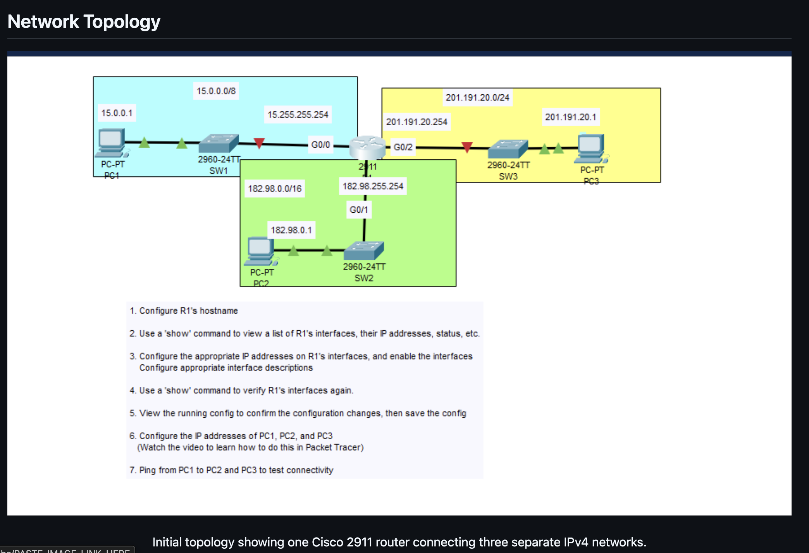

One Cisco 2911 router connects three LANs. Each LAN contains a 2960-24TT switch and one PC. The initial topology shows the router links before interface activation.

## Lab Objectives

- Set the router hostname and inspect its interfaces.
- Assign IPv4 addresses and enable the router ports.
- Understand how interface descriptions identify connected networks.
- Configure host addresses and default gateways.
- Check interface status and save the configuration.
- Test local gateway access and communication between subnets.

## Addressing Plan

| LAN | Network | PC address | Subnet mask | Switch | R1 interface | Default gateway |
| --- | --- | --- | --- | --- | --- | --- |
| A | 15.0.0.0/8 | PC1: 15.0.0.1 | 255.0.0.0 | SW1 | G0/0 | 15.255.255.254 |
| B | 182.98.0.0/16 | PC2: 182.98.0.1 | 255.255.0.0 | SW2 | G0/1 | 182.98.255.254 |
| C | 201.191.20.0/24 | PC3: 201.191.20.1 | 255.255.255.0 | SW3 | G0/2 | 201.191.20.254 |

Each PC uses the router address in its own subnet as its default gateway.

## 1. Name the Router

I entered global configuration mode and changed the router name to R1.

```text
enable
configure terminal
hostname R1
```

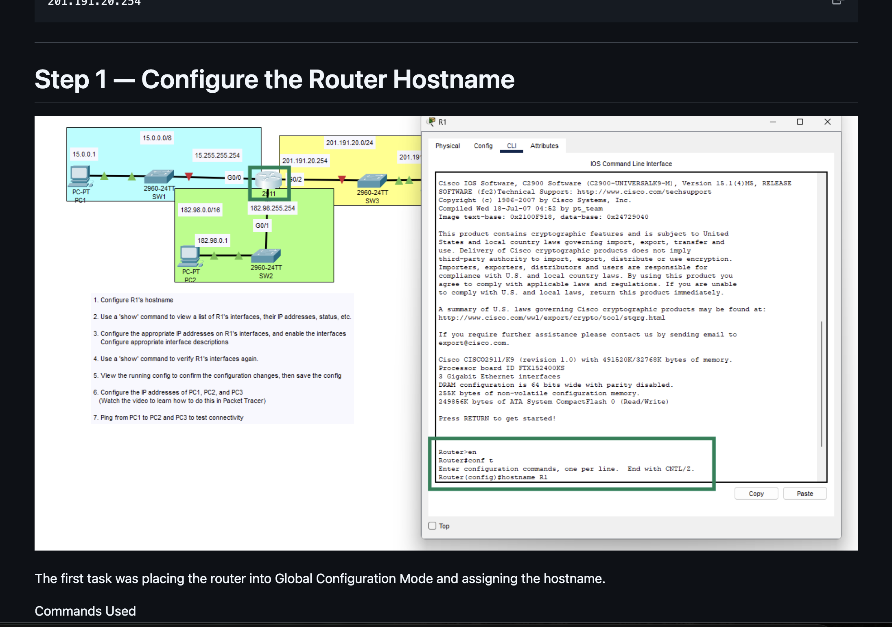

The hostname appears in the CLI prompt, making it easier to identify the device being configured.

## 2. Check the Starting Interface State

From configuration mode, I checked the interface summary:

```text
do show ip interface brief
```

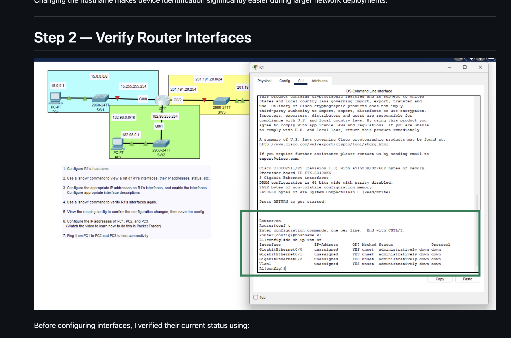

The three GigabitEthernet interfaces initially had no IP addresses and showed `administratively down`. They needed both an address and the `no shutdown` command.

## 3. Address and Enable the Router Interfaces

I configured one router interface for each LAN using its assigned address and subnet mask.

```text
interface gigabitEthernet0/0
 ip address 15.255.255.254 255.0.0.0
 no shutdown
 exit
interface gigabitEthernet0/1
 ip address 182.98.255.254 255.255.0.0
 no shutdown
 exit
interface gigabitEthernet0/2
 ip address 201.191.20.254 255.255.255.0
 no shutdown
 exit
```

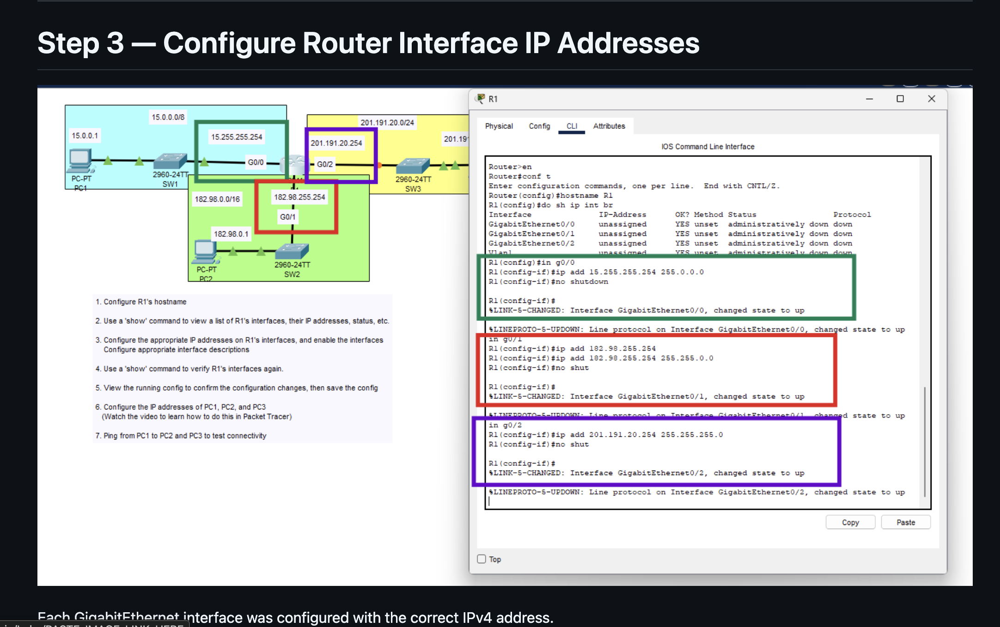

The console reported link and line-protocol transitions to `up` as the interfaces became active.

Interface descriptions were also part of the lab instructions. The screenshots do not show their configuration; examples of suitable labels are:

```text
interface gigabitEthernet0/0
 description LAN A - connection to SW1
interface gigabitEthernet0/1
 description LAN B - connection to SW2
interface gigabitEthernet0/2
 description LAN C - connection to SW3
```

## 4. Confirm the Interfaces Are Operational

I repeated the interface check after assigning the addresses:

```text
do show ip interface brief
```

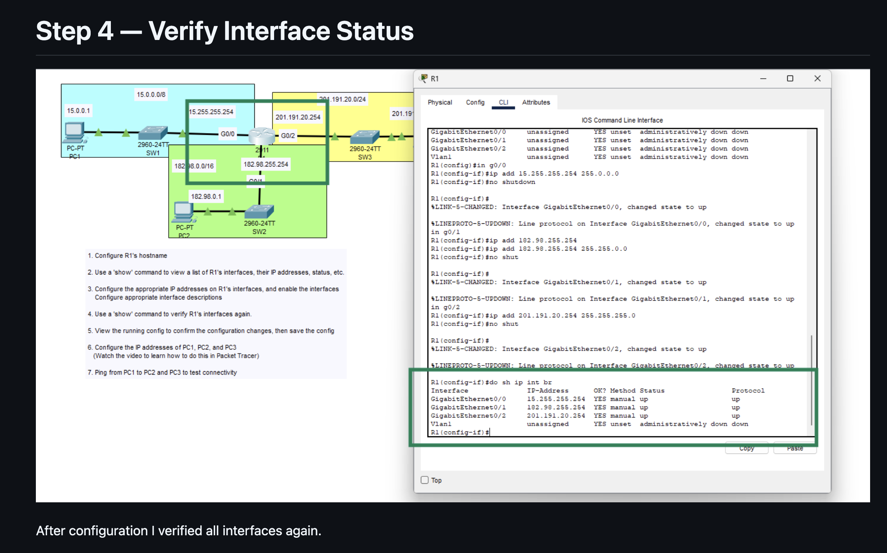

| Interface | IPv4 address | Status | Protocol |
| --- | --- | --- | --- |
| G0/0 | 15.255.255.254 | up | up |
| G0/1 | 182.98.255.254 | up | up |
| G0/2 | 201.191.20.254 | up | up |

All three LAN-facing interfaces showed `up/up`. The unused Vlan1 interface remained unassigned and administratively down. Interface status confirms that the links are operational; host connectivity still needs a separate test.

## 5. Save the Router Settings

The save attempt shown in the screenshot first used `write` from interface configuration mode, which produced an error. Adding `do` allowed the command to run successfully:

```text
R1(config-if)# do write
Building configuration...
[OK]
```

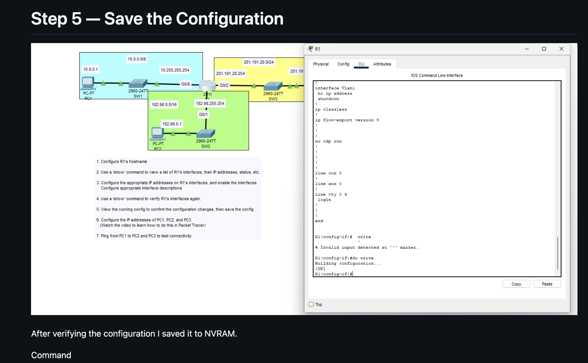

Another way to save is to return to privileged EXEC mode and copy the active configuration to startup configuration:

```text
end
copy running-config startup-config
```

Saving preserves the settings for the next startup. The screenshot confirms the save completed; a reload test is not shown.

## 6. Configure the PCs and Check Their Gateways

I used the addressing plan to configure each PC, then checked its settings with `ipconfig` and pinged its local router interface.

### PC1 — LAN A

PC1 uses `15.0.0.1/8` with gateway `15.255.255.254`.

```text
ipconfig
ping 15.255.255.254
```

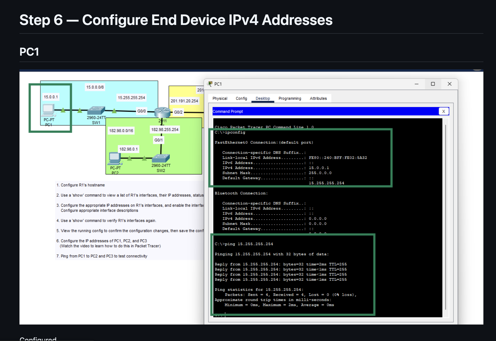

### PC2 — LAN B

PC2 uses `182.98.0.1/16` with gateway `182.98.255.254`.

```text
ipconfig
ping 182.98.255.254
```

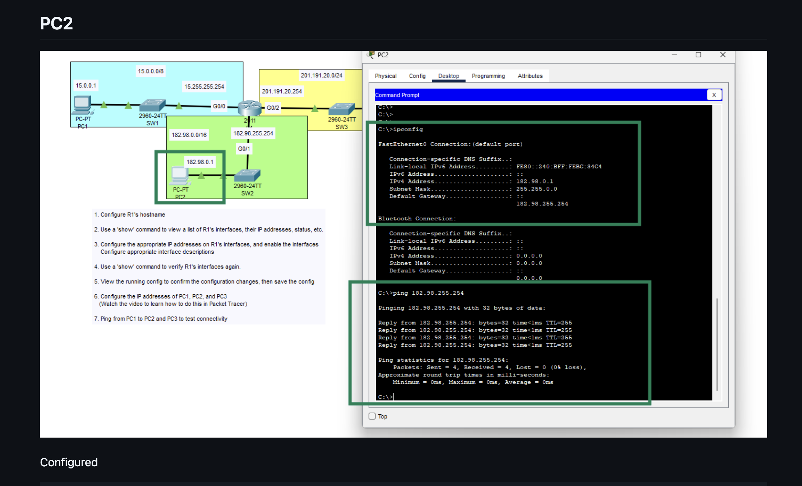

### PC3 — LAN C

PC3 uses `201.191.20.1/24` with gateway `201.191.20.254`.

```text
ipconfig
ping 201.191.20.254
```

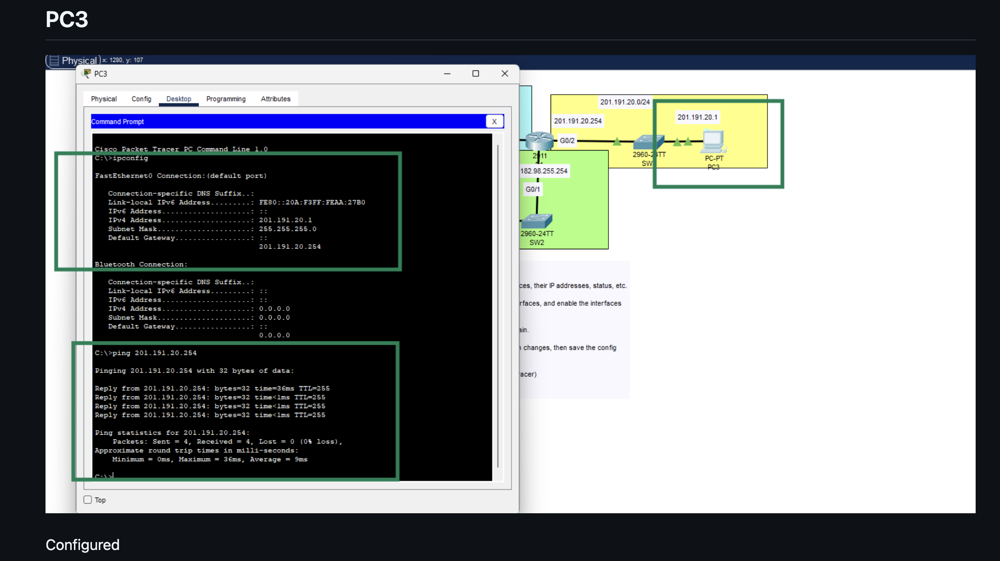

Each gateway test returned four replies with 0% packet loss.

## 7. Test Communication Across Subnets

After confirming local gateway access, I tested the two remote PCs from PC1.

### PC1 to PC2

```text
ping 182.98.0.1
```

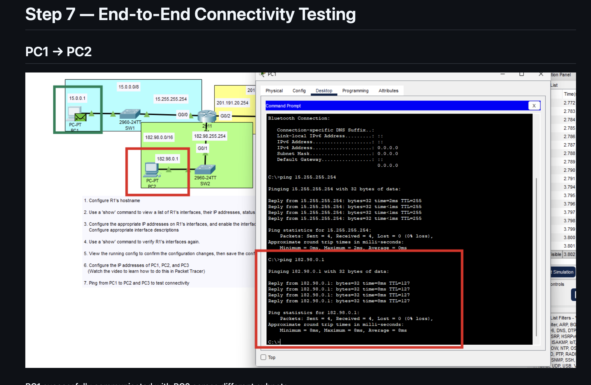

### PC1 to PC3

```text
ping 201.191.20.1
```

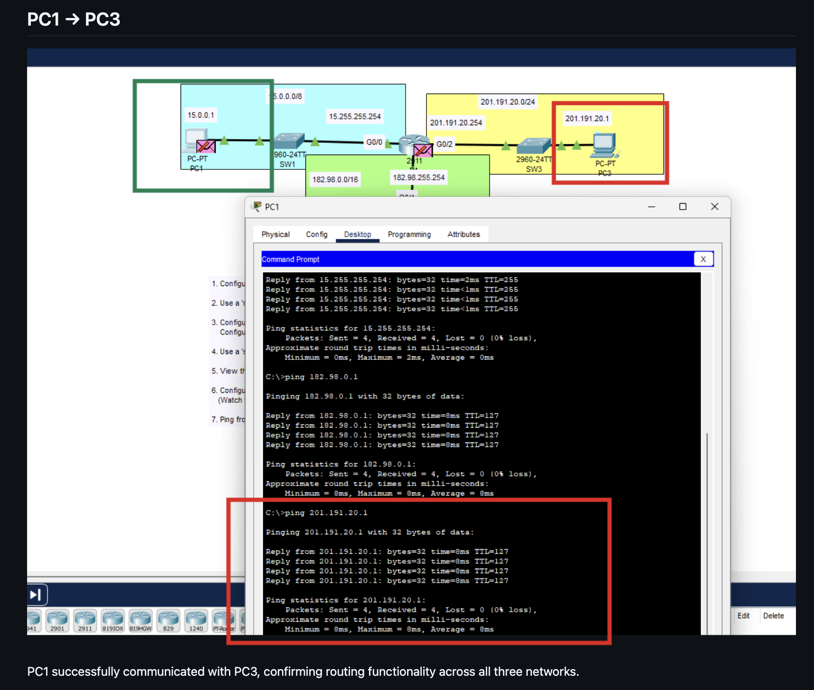

Both tests returned four replies with 0% packet loss. These results demonstrate that R1 forwarded traffic between LAN A and each of the other two networks. A separate PC2-to-PC3 test is not shown.

All three networks connect directly to R1, so static routes are not required for these paths.

## Command Reference

| Command | Purpose |
| --- | --- |
| `enable` | Enter privileged EXEC mode |
| `configure terminal` | Enter global configuration mode |
| `hostname R1` | Assign the router name |
| `show ip interface brief` | Review interface addresses and status |
| `interface gigabitEthernet0/0` | Select an interface |
| `ip address <address> <mask>` | Set an interface IPv4 address |
| `no shutdown` | Enable an interface administratively |
| `description <text>` | Label an interface connection |
| `do write` | Save from configuration mode |
| `copy running-config startup-config` | Save from privileged EXEC mode |
| `ipconfig` | Check a PC's addressing |
| `ping <address>` | Test IP reachability |

## What I Learned

This exercise helped me connect the addressing plan to the actual device configuration. A PC needs the correct subnet mask to determine whether a destination is local, and a default gateway to reach other networks.

I also practiced separating verification into stages: check the router interfaces, confirm each PC can reach its gateway, and then test a remote host. This makes it easier to locate a problem if a ping fails.

The save-command error reinforced the importance of checking the CLI prompt. Commands available in privileged EXEC mode may need the `do` prefix when used from configuration mode.

## Lab Status

✅ **Lab 08 complete — interface setup and the documented connectivity tests verified.**

Screenshot evidence is included above. The Packet Tracer `.pkt` file is pending.

**Topics practiced:** IPv4 addressing, subnet masks, default gateways, router interfaces, IOS command modes, ICMP testing, and configuration saving.

**Next topic:** Static routing and IPv4 routing fundamentals.
